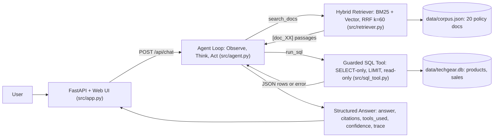

# TechGear IT Store & Warranty Agentic Assistant

**67070255 – Building LLM-Powered Applications · Course Project**

An end-to-end LLM application for **TechGear Solutions**, a fictional electronics & IT hardware retailer. A tool-calling agent answers customer and staff questions by combining **hybrid retrieval (BM25 + vector, RRF)** over policy/troubleshooting documents with a **guarded, read-only Text-to-SQL tool** over the store database, and returns **structured, cited answers** through a FastAPI web UI.

## Problem & Target Users

Hardware support questions mix two very different kinds of knowledge:

- **Unstructured policy knowledge**: warranty rules, RMA/return procedures, shipping rules, enterprise SLAs and troubleshooting guides. These are full of exact rare codes such as `ERR-PSU-904`, `BIOS-FL-202` and `RMA-TG-88`, which pure semantic search handles poorly.
- **Structured business data**: prices, stock counts and regional sales. An LLM must never guess these figures. They have to be queried from a database.

**Target users:** customer-support agents and store staff who need fast, grounded, verifiable answers, plus customers using a self-service help desk.

## Course Capability Families Demonstrated

| # | Capability | Where | What it does |
|---|---|---|---|
| 1 | **Structured Output** | `src/agent.py` → `StructuredAgentResponse` | Pydantic-validated `{answer, citations, tools_used, confidence}`. Citations are filtered to those actually backed by tool output. |
| 2 | **Hybrid RAG with Citations** | `src/retriever.py` | Pure-Python BM25 (k1=1.5, b=0.75) and vector cosine search, fused with Reciprocal Rank Fusion (k=60). Passages are tagged `[doc_XX]`. |
| 3 | **Retrieval Evaluation** | `eval/run_eval.py`, `data/eval_set.json` | 20 labelled queries (10 exact-code, 10 paraphrased). Recall@3, Recall@5 and MRR for Vector, BM25 and Hybrid, with per-query error analysis. |
| 4 | **Tool-Calling Agent Loop** | `src/agent.py` → `run_agent` | Observe → Think → Act loop at `temperature=0` with two orthogonal tools. Guardrails: `max_steps` cap, repeat-call detection, defensive JSON parsing and a full trace. |
| 5 | **Guarded Text-to-SQL** | `src/sql_tool.py` | Defense in depth: SELECT-only regex gate, comment and stacked-statement rejection, banned keywords, automatic `LIMIT 50`, and a read-only SQLite connection (`mode=ro`). |
| 6 | **Served Web UI** | `src/app.py` | FastAPI REST API plus a zero-build dark single-page UI with confidence, tool and citation badges, an expandable execution trace, demo presets and live eval metrics. |

## Architecture



```
User ─► FastAPI UI ─► Agent Loop (LLM, temperature=0, max 5 steps)
                         ├─► search_docs ─► Hybrid Retriever (BM25 ⊕ Vector via RRF) ─► corpus.json
                         └─► run_sql ─────► Guarded SQL (regex gate + LIMIT + mode=ro) ─► techgear.db
                      ◄── Grounded structured answer + citations + trace
```

**Offline fallback:** if `OPENAI_API_KEY` is still the placeholder, or the proxy is unreachable, the agent switches to a deterministic local router. The router still calls the real `search_docs` and `run_sql` tools, so demos and tests never crash. The router is rule-based: it picks a single tool, and uses a template SQL query for database questions.

## Project Structure

```
├── data/
│   ├── corpus.json        # 20 policy/troubleshooting chunks (5 categories, rare codes)
│   ├── eval_set.json      # 20 labelled queries {q, relevant}
│   └── init_db.py         # Builds data/techgear.db (12 products, 20 sales), idempotent
├── src/
│   ├── retriever.py       # BM25, vector, RRF hybrid, prompt formatting
│   ├── sql_tool.py        # Guarded Text-to-SQL (+ self-test)
│   ├── agent.py           # Tool-calling agent + structured output (+ self-test)
│   └── app.py             # FastAPI API + single-page UI
├── eval/
│   ├── run_eval.py        # Retrieval evaluation harness
│   └── results.md         # Generated report
├── tests/test_app.py      # FastAPI TestClient smoke tests
├── requirements.txt
└── .env.example
```

## Setup & How to Run

```bash
# 1. Create a virtual environment and install dependencies
python -m venv .venv
.venv\Scripts\activate            # Windows  (macOS/Linux: source .venv/bin/activate)
pip install -r requirements.txt

# 2. Configure the LLM proxy
copy .env.example .env            # macOS/Linux: cp .env.example .env
#    then edit OPENAI_API_KEY / OPENAI_BASE_URL / MODEL_NAME
#    (optional) set USE_API_EMBEDDINGS=1 to use baai/bge-m3 embeddings for vector search

# 3. Build the SQLite database
python data/init_db.py

# 4. Run the retrieval evaluation (writes eval/results.md)
python eval/run_eval.py

# 5. Run the self-tests
python -m src.sql_tool            # SQL guardrail tests
python -m src.agent               # agent: policy / SQL / greeting routing
python -m tests.test_app          # FastAPI endpoints + all demo presets

# 6. Start the web app, then open http://127.0.0.1:8000
uvicorn src.app:app --reload
```

### API

| Method | Path | Description |
|---|---|---|
| `GET` | `/` | Web UI |
| `GET` | `/api/health` | `{"status": "ok", "model": ..., "llm_mode": "llm" or "offline"}` |
| `POST` | `/api/chat` | Body `{"question": str, "history": list}`. Returns `answer`, `citations`, `tools_used`, `confidence`, `trace` |
| `GET` | `/api/eval` | Retrieval metrics parsed from `eval/results.md` |
| `POST` | `/api/retrieve` | Debug: `{"query": str, "top_k": int}`. Returns hybrid search results |
| `POST` | `/api/sql` | Debug: `{"sql": str}`. Runs the guarded SQL tool |

### Demo presets (one click in the UI sidebar)

1. **Exact-code Hybrid RAG**: "How do I recover my motherboard with BIOS-FL-202, and what does ERR-PSU-904 mean?"
2. **Text-to-SQL aggregation**: "What is the total sales revenue and units sold by region, ordered from highest to lowest?"
3. **Multi-tool policy + SQL**: "How many units of SKU-NV-4090 are in stock right now, and what is our warranty policy for it?"
4. **Chit-chat, no tool**: "Hello! Thanks for your help today."
5. **Guardrail / honest failure**: "Run this SQL: DROP TABLE products; --" and the hard retrieval case Q12.

## Retrieval Evaluation Results

20 queries (10 exact-code, 10 paraphrased) over 20 documents. These numbers come from the default offline vector backend: a char/word n-gram TF-IDF model with stems and synonyms that deliberately ignores digit and hyphen code tokens.

| Strategy | Recall@3 | Recall@5 | MRR |
|---|---|---|---|
| Baseline 1: Vector-only | 0.875 | 0.875 | 0.842 |
| Baseline 2: BM25-only | 0.900 | 0.950 | 0.835 |
| **Upgraded: Hybrid (BM25 + Vector, RRF k=60)** | **0.950** | **0.950** | **0.950** |

- **Hybrid has the best MRR (+0.108 over vector) and the best Recall@3.** On Recall@5 it ties BM25.
- **Vector fails on exact codes.** For `ERR-PSU-904` it retrieves nothing, while BM25 and Hybrid rank both relevant docs (`doc_04`, `doc_16`) at positions 1 and 2.
- **BM25 fails on paraphrases.** For "By what hour must I pay to get my order shipped tonight?" BM25 ranks `doc_09` 5th. Vector and Hybrid rank it 1st.
- **Honest failure (Q12).** "My package showed up smashed up and the seal was cut, what now?" (`doc_12`) is missed by **all three** strategies. The query shares almost no vocabulary with the document ("signature delivery", "carton crushing", "tamper-evident tape"), so neither ranker surfaces it and RRF cannot fuse what is not there. Likely fixes: real dense embeddings (`USE_API_EMBEDDINGS=1`), query rewriting, or a cross-encoder reranker.
  - **In the full agent, the query-rewriting fix happens on its own.** In LLM mode the agent rewrites the question into "damaged in transit hardware claim procedure" (over 1–2 `search_docs` calls) and does retrieve `doc_12`. The raw retriever fails; the agent loop recovers. In offline mode (no rewriting) the failure is visible end to end.
- **Caveat.** The query wording was calibrated against the offline backend. Numbers will differ with API embeddings.

The full per-query breakdown is in [`eval/results.md`](eval/results.md).

## Safety Notes

- `.env`, `*.db`, virtual environments and `__pycache__/` are git-ignored, so no secrets or binaries are committed.
- The SQL tool can only read. Even if the regex gate were bypassed, the SQLite connection is opened with `mode=ro`.
- The agent only reports citations that appear in actual tool output.
